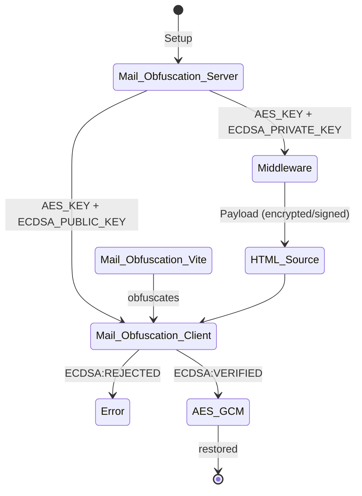

# Astro Mail Obfuscation

<picture><source media="(prefers-color-scheme: dark)" srcset="https://www.shieldcn.dev/npm/dt/astro-mail-obfuscation.svg?variant=secondary&amp;size=sm&amp;mode=dark&amp;font=space-grotesk"></picture> <picture><source media="(prefers-color-scheme: dark)" srcset="https://www.shieldcn.dev/npm/astro-mail-obfuscation.svg?variant=secondary&amp;size=sm&amp;mode=dark&amp;font=space-grotesk"></picture>

> **v3**: **Rebuilt**. Advanced content obfuscator for [Astro](https://astro.build/) and [Starlight](https://starlight.astro.build/).

Supports SSR, SSG, [`<ClientRouter />`](https://docs.astro.build/en/guides/view-transitions/), and Trusted Types.

- Demo: [https://andreas-brunner.github.io/astro-mail-obfuscation/](https://andreas-brunner.github.io/astro-mail-obfuscation/)

### Background

Bots crawl the web for email addresses, phone numbers, and other personal data. This can lead to spam emails, unwanted calls, and other forms of abuse (e.g., invoice fraud).

Most of them take a straightforward approach. However, common obfuscation techniques (e.g., XOR, ROT13) can become predictable once their implementation patterns are known.

### Approach

Astro Mail Obfuscation minimizes stable patterns that bots can reuse. Each build generates new attribute names, keys, and produces a client runtime obfuscated with [JavaScript Obfuscator](https://github.com/javascript-obfuscator/javascript-obfuscator). Content is AES-GCM-encrypted and ECDSA-signed, while the client deliberately avoids exposing errors.

## Source Comparison

**Without**:

```html
<a href="tel:+498999998000">+49 89 99998 000</a>
```

**With Astro Mail Obfuscation**:

```html
<a data-c8c327ad7b16="IcB8lePUuQlN..."></a>
```

JavaScript restores the content on the client side.

## Installation

> Requires Node.js `>=22.12.0`, Astro `>=5.0.0 <8.0.0`, and a [secure context](https://developer.mozilla.org/en-US/docs/Web/Security/Defenses/Secure_Contexts) (localhost or HTTPS).

**Astro CLI** (recommended):

```bash
npx astro add astro-mail-obfuscation
```

**Manual**:

```bash
npm install astro-mail-obfuscation
# or pnpm add / yarn add / bun add
```

```js
// astro.config.mjs
import { defineConfig } from "astro/config";

import mailObfuscation from "astro-mail-obfuscation";

export default defineConfig({
    integrations: [mailObfuscation()],
});
```

### Migration from v2 to v3

Remove all deprecated options from `mailObfuscation()` in `astro.config.mjs`. Marker values are no longer evaluated; change `data-obfuscation="..."` to `data-obfuscation`.

## Usage

Add the `data-obfuscation` marker to any HTML content element:

```html
<a href="mailto:john.doe@example.com" data-obfuscation>
    <span>john.doe@example.com</span>
</a>

<p>Tax ID: <span data-obfuscation>[TAX_ID]</span></p>

<address data-obfuscation>
    John Doe's Placeholder Emporium<br />
    [STREET]<br />
    [POSTAL_CODE], [CITY]<br />
    [COUNTRY]
</address>
```

All attributes except critical ones (e.g., `id`, `class`, `style`, `hidden`) are obfuscated.

> Do not nest `data-obfuscation` or include `<noscript>` in obfuscated content. Do not obfuscate `<astro-island>` or its contents, and do not use custom elements as marked roots.

### Optional Configuration

Provide a `<noscript>` notice for users without JavaScript:

```html
<div>
    <a href="mailto:..." data-obfuscation>
        <span>...</span>
    </a>
    <noscript>Please enable JavaScript.</noscript>
</div>
```

> Do not put sensitive data inside `<noscript>`; use it for a general notice.

To replace the default marker, set `markerAttributeName`:

```js
// astro.config.mjs
mailObfuscation({
    markerAttributeName: "data-shield", // /^data-[a-z0-9_-]+$/
});
```

```html
<a href="mailto:..." data-shield>...</a>
```

## Architecture



The client runtime needs the `AES_KEY` to decrypt the payload. Because the same key can also be used to create a valid modified payload, [AES-GCM](https://developer.mozilla.org/en-US/docs/Web/API/SubtleCrypto/encrypt#aes-gcm) alone cannot verify where the payload came from.

[ECDSA](https://developer.mozilla.org/en-US/docs/Web/API/SubtleCrypto/sign#ecdsa) provides this verification. The client runtime receives only the `ECDSA_PUBLIC_KEY`; the `ECDSA_PRIVATE_KEY` remains on the build/server side.

### SSR Behavior

In SSR mode, HTML responses are buffered.

This is required because the integration needs the complete HTML document for validation and transformation. As a result, [HTML responses cannot be streamed](https://docs.astro.build/en/guides/on-demand-rendering/#html-streaming).

> The middleware does not parse or reserialize marker-free HTML, and [Cheerio](https://github.com/cheeriojs/cheerio) is loaded lazily. All HTML responses are still inspected, and the small client runtime is injected on every page.

## Threat Model

Obfuscation is not security. Instead, it raises the cost of automated data extraction.

Astro Mail Obfuscation protects against crawlers and scrapers that inspect raw HTML. It disrupts tools that rely on predictable patterns or static extractors.

Because the integration randomizes its client runtime and regenerates identifiers and cryptographic keys on every build, a single static extractor becomes significantly harder to reuse across sites and builds.

## Security

Astro Mail Obfuscation does not sanitize HTML.

Sanitize your content before obfuscation if it comes from an untrusted source (e.g., content management system, user input). For example, use [DOMPurify](https://github.com/cure53/DOMPurify).

### Trusted Types

If your [CSP](https://developer.mozilla.org/en-US/docs/Web/HTTP/Guides/CSP) restricts [Trusted Types](https://developer.mozilla.org/en-US/docs/Web/API/Trusted_Types_API) policy names, configure a static one:

```js
// astro.config.mjs
mailObfuscation({
    trustedTypesPolicyName: "tt-a7f3c9", // pass-through only; no sanitization
});
```

> Avoid `astro-mail-obfuscation` and other obvious names. This option does not modify your CSP headers. Allow the same policy name in your `trusted-types` directive.

## License

[MIT](LICENSE) - (c) 2024-2026 [Andreas Brunner](https://github.com/andreas-brunner).

Built in Germany.
